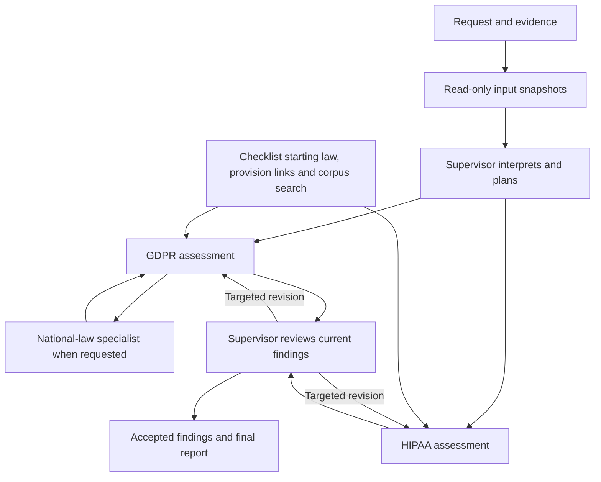

# v18 case ownership and information flow

A run accepts only `organisations → transfer → evidence`, with `transfer.sender` and
`transfer.recipient` naming organisation IDs. The `case_record.input` holds one validated input
plus `reference_facts`; there is no intermediate legacy request or duplicate submitted copy.
Identifiability stays as supplied, storage/access stay separate, and evidence retains its IDs,
`between` scope and optional actual `attested_by`. Legal classification belongs to agents.

| Section | Writer | Meaning |
| --- | --- | --- |
| `input` | Python, once at intake | Validated input and reference country facts. Read-only thereafter. |
| `supervisor.intake`, `interpretation`, `exclusions`, `plans` | Supervisor | Claims, provisional roles/data/activity classifications and initial assignments. These are not requester facts. |
| `specialists[agent]` | That specialist | Current applicability, findings, statuses, reasoning, evidence IDs and legal references. GDPR also owns its national-law questions and child answers. |
| `supervisor.action_log`, `review` | Supervisor | Targeted revision requests, explicit acceptance of current finding IDs, reconciliation and final decision. |
| `checks` | Python | Coverage, reference integrity, execution failures and separate research warnings. Checks never replace legal statuses. |

Models receive serialized views and return scoped output schemas. They cannot write input fields
or another agent's findings. Revised answers replace only the questions assigned for revision;
unchanged answers keep their IDs. Superseded outputs remain in the event trace.
At `app.llm.ask`, OpenAI responses are constrained through native strict JSON Schema,
using fresh copies of those existing Pydantic schemas. Every object forbids extra keys
and requires all its fields; existing nullable unions remain nullable and defaults are
removed from the API schema. References with sibling annotations are inlined with
their descriptions preserved, since the API rejects annotated `$ref` objects.
Factual references have an enum of this call's supplied
input passage IDs. This applies to plans, intake/interpretation/exclusion repairs,
all specialists and targeted revisions, without changing stored model definitions.
Specialist quote IDs select from one shared enum of displayed legal passages.
Tool reads grow that catalogue, and the response schema is refreshed before each
invocation. Unread pages and search/KG suggestions do not become selectable quotes.
Findings retain the permitted empty quote; routes require a displayed passage ID.
The response format stays bound during the existing tool loop and after tools are removed
at the budget boundary. LangChain sends `response_format` for ordinary Chat Completions
and translates it to `text.format` for tool-using Responses calls. Source checks still
apply, including for legal quote IDs introduced by later tool reads. Other providers
retain prompt-based JSON. Refusal/incomplete API replies become execution failures;
OpenAI errors never silently switch to unconstrained output. Schema adherence cannot
establish legal correctness or research completeness. Request traces identify the mode,
schema and factual-choice count. The original v15 input format and agent flow are unchanged.
v18 quotation passages keep retained paragraphs and numbered blocks whole instead of
splitting at 40 words. Colon-led numbered lists stay with their introduction; ambiguous
structure remains intact. Passage IDs use v2. Source wording, embedding windows, model
calls and legal ownership are unchanged. Long source blocks can produce longer saved quotes.
Fact-reference views are copies of `case_record.input`: organisations, transfer and evidence at
the root, alongside `reference_facts`. The supervisor review view puts the same document in
`input`; fact pointers omit that wrapper. Example paths are `/organisations/0/country`,
`/transfer/data/identifiability`, `/transfer/locations/accessed_from/0` and `/evidence/0/summary`.
Organisation order does not decide sender/recipient: agents resolve their transfer IDs against
`organisations`. Python validates IDs, standardizes country codes, retains omissions and unknowns,
and adds stored reference metadata. It does not infer roles or generate an attester. References address scalar values, including indexed array items.
Input passages are labelled with stable `f_` IDs bound to an escaped pointer, source
offsets and exact text. Sentences stay whole, including negated lists; empty/null values
are not passages, while booleans, numbers and explicit unknowns remain selectable.
Every agent receives the original JSON and these same labelled passages. Response schemas
ask only for `fact_id`, including intake sources and supervisor corrections. Python copies
the pointer and quotation together before validation and storage, preserving readable
`fact_id/path/quote` references. Unknown IDs are rejected without guessing a replacement;
saved IDs are checked against their exact bound text and location. This adds no model call
and does not establish that a passage supports the agent's reasoning. Historical reports
without input passage IDs retain their existing quotation checks.
Targeted review prompts include the affected questions' pinned sources, previously cited
law (including route-only citations) and explicit source additions, instead of repeating
the whole regime source pack. The same route law reaches supervisor review and national
child source handoff to GDPR. Supervisor review also includes the assigned checklist's
starting provisions and supporting context, so it can check alternatives omitted from
the findings and therefore absent from their citations.
Every supervisor review also receives `checks.requirement_policy`: assigned
question IDs mapped to catalogue `class` and `class_reason`, including when follow-up
budgets are exhausted. The same catalogue drives Python's decision checks. Requirement
class and a specialist's actor/activity scope are separate; transfer scope does not
turn an advisory duty into a gate. Rejected refusals identify unmet non-gate keys/classes.
The supervisor sees each available target's permitted question IDs and the parent GDPR requirement
for each child question. National-law children receive the referenced GDPR opening text as context
alongside national law, within the source budget; GDPR still owns the resulting GDPR status.

All model-authored delegation, national-law and source requests pass through
`app.requests.prepare_request` before execution (pending national requests are validated too).
Their existing Pydantic schemas define each operation's arguments. The shared function normalizes
formatting against current IDs, checks scope and legal-source IDs, returns a validated copy, and logs
`request_validated` or `request_rejected`. It does not guess an unknown ID, convert a child question
into a parent question, or infer a legal conclusion. A rejected sibling request remains visible while
valid requests can execute. Initial checklist questions continue to come from `plan_questions`.

This is a callable request boundary behind the existing JSON action protocol, not a switch to a
provider-native tool API. Agent wording and legal judgment remain free; routing metadata is checked.

Specialist calls offer provider-native tools (`app/traversal.py`): `kg_node` (a provision
and its typed edges), `search_law` (provision IDs within the specialist's regime) and `read_provision`
(text, own regime only). The graph contains source provisions and their citation, amendment
and definition links only. Checklist anchors select initial reading; there is no injected
requirement/route/condition guidance. Tools extend the source pack within `MAX_TOOL_CALLS`.
`read_provision(provision_id, start=0)` pages whole labelled passages, targeting 6,000
source-text characters and permitting one oversized passage whole. `next_start` continues
across every provision chunk resolved by that same ID; every page uses an existing tool call.
Python answers every call, logs it, and adds provisions actually
read to the agent's citable sources; searching alone does not make a provision citable. The supervisor has
no tools. `TRAVERSAL_TOOLS=0` disables these tools while retaining checklist starting sources.
Retrieval resolves exact provision IDs and/or searches the stored corpus, then follows curated
amendment and definition links. For example, Irish DPA s. 52 brings its Health Identifiers Act
definition and the referenced Medical Practitioners Act definitions. The function returns source
IDs/text through the next assessment prompt. It does not autonomously download new legislation.
Source-count caps apply before mandatory linked context; an already-available result adds no call.

Supervisor plans expose only applicability and review focus; national-law requests belong to GDPR.
Specialists assess plausible legal routes against the combined facts rather than treating an absent
requester-selected basis as an automatic gap. They identify unresolved legal sources in `missing_law`
and can explain why further research cannot help in `research_stopping_reason`.
Each finding now includes `route_coverage`, a short account of alternatives/exceptions,
grouped exclusions and remaining limits in read law. A simple duty or applicability
exclusion can explain itself without a separate list. Other findings include compact
`routes` with a scoped name, supported/ruled_out/unresolved/not_investigated status,
assessment or deferral reason, citations and a selected quote ID. `ruled_out` requires
assessed facts/law that exclude the route; merely not choosing it is insufficient.
`not_investigated` records an optional fallback recognised in read law whose feasibility
was deliberately left unassessed because a named supported route suffices for the same
actor/activity. It cannot defer mandatory prerequisites, cumulative safeguards,
restrictions or exceptions to the chosen route. Python copies and checks route quotes like
finding quotes. It never derives the parent status from route counts or statuses.
The supervisor compares this record with source clauses, checking alternatives,
exceptions and cumulative duties before accepting findings. A justified optional deferral
does not require research solely to finish every fallback. A challenge identifies the
specific branch/duty, why current reasoning does not settle it, and what focused check
would. A failed national branch
affects that branch; unresolved alternatives remain unresolved. Approval still needs
applicable prerequisites and cumulative duties. Route discovery and legal completeness
remain model judgments within the supplied corpus, not a structural guarantee.
No mandatory model phase or extra call budget is added. Unsupported refusal proposals
are rejected: refusal needs a verified unmet main transfer gate or an explicit
incompatibility between conclusive, verified main transfer findings.
Python records executed source requests in `source_research`, including no-hit searches, and retains
them across revisions and child revisits. The supervisor sees compact child research metadata alongside
the flattened child findings, without duplicate child source packs. `checks.research_warnings` flags
declared legal gaps without corresponding
research or a stopping explanation. National delegation is matched to its parent requirement;
pending requests do not count as executed searches. These are non-blocking process warnings, not
legal findings. The supervisor reviews relevance, results and stopping reasons, then requests a
useful follow-up or explains the remaining limit. No extra model call is added automatically.

Optional supervisor interpretation, intake and exclusion replacements are checked separately from its requested
action. A valid intake replacement can repair quotations or withdraw unsupported claims without
changing input or specialist findings. Invalid replacements preserve the prior section and report
the exact reference defects; a valid `needs_review` finish can still be recorded. Other final decisions
remain blocked until the defect is corrected. Intake checks locate quoted text, not semantic support:
the supervisor must also check whether each statement and instruction label follows from its passage.
Original and replacement outputs stay in the trace; action logs record update acceptance or rejection.
Exclusion repair must retain exactly the existing excluded regimes and cite supplied facts/law;
it can correct reasoning and references without changing routed plans or specialist findings.
Rejected repairs retain the prior exclusions and block favourable completion until corrected.
An independent `needs_review` or established-gate refusal can still finish in that response.

The provision graph supplies lookup and navigation, not legal conditions or statuses. The checklist
outside the graph retains fixed coverage and starting provisions. Specialists infer legal routes,
prerequisites, scope and exceptions from source text. National-law questions cite GDPR provisions
and describe the dependency; local retrieval uses search and reverse provision citations rather than
predefined implementation nodes. Specialists can request bounded extra retrieval. Python runs the requested work
and enforces call/source budgets. The supervisor interprets the case and controls follow-up work;
each call receives current state rather than a growing conversation transcript.

Evidence summaries establish their stated contents and scope. Authenticity is assumed for this
prototype, but a document's kind or title does not establish every legal predicate. A missing
decisive predicate stays unresolved. Non-decisive confirmations are reported separately.
